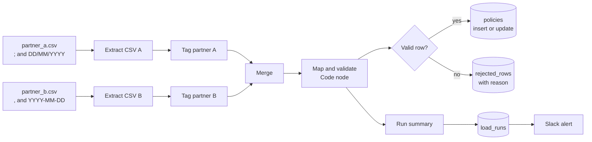

# Partner data onboarding with n8n

An n8n workflow that onboards insurance policy files from two partners who send data in different formats. It maps each partner's columns to one target schema, validates every row, loads the valid rows into PostgreSQL and logs every rejected row with a reason. Each run is recorded, and a Slack alert can send the summary.

This is a portfolio project on simulated data. It reproduces a common situation for a platform that works with many distribution partners: every partner sends the same business data in its own format.



## What it does

- Reads two partner CSV files with different separators, column names, date formats and decimal formats.
- Maps both to one schema: policy_id, partner, customer_email, product, start_date, premium_eur. The full mapping is in [docs/mapping_spec.md](docs/mapping_spec.md).
- Validates each row: required fields, email format, real calendar dates, premium greater than 0, no duplicate policy id.
- Loads valid rows with `INSERT ... ON CONFLICT DO UPDATE`, so the workflow is safe to run again: a rerun updates rows instead of creating duplicates.
- Writes each rejected row to `rejected_rows` with the original data and the reason, so the partner can be told exactly what to fix.
- Saves one row per run in `load_runs` and builds a summary message for Slack.

## Results on the sample files

| | Partner A | Partner B | Total |
|---|---|---|---|
| Rows received | 20 | 20 | 40 |
| Loaded | 16 | 16 | 32 |
| Rejected | 4 | 4 | 8 |

Rejection reasons found: missing email, invalid email, impossible date (31/02/2026 and month 13), premium of 0 or below, duplicate policy id. Running the workflow a second time keeps 32 policies: nothing is duplicated.

## How to run

Requirements: Docker Desktop.

```bash
docker compose up -d
```

1. Open http://localhost:5678 and create the n8n owner account.
2. Import the Postgres credential and the workflow:
   ```bash
   docker compose exec n8n n8n import:credentials --input=/credentials/postgres_beloy.json
   docker compose exec n8n n8n import:workflow --input=/workflows/partner_onboarding.json
   ```
3. Open the workflow "Partner data onboarding" in n8n and click **Execute workflow**.
4. Check the database:
   ```bash
   docker compose exec postgres psql -U beloy -d partners -c "select partner, count(*) from policies group by 1;"
   docker compose exec postgres psql -U beloy -d partners -c "select partner, reason from rejected_rows;"
   ```
5. Optional: enable the "Send alert to Slack" node and paste your Slack incoming webhook URL.

## Tests

The mapping and validation logic lives in `scripts/transform.js` and is tested with Node's built-in test runner:

```bash
npm test
```

`scripts/build_workflow.js` copies that same logic into the n8n Code node and regenerates `workflows/partner_onboarding.json`. GitHub Actions runs the tests and checks that the workflow file matches the tested code, so the logic in n8n and the tests can't drift apart.

## Design choices

- **Validate before loading.** Bad rows never reach the target table. They go to `rejected_rows` with a reason, which is what a partner needs to fix their export.
- **Mapping as configuration.** Each partner is one entry in `MAPPINGS`. A new partner doesn't change the validation or the load.
- **Safe to rerun.** The load uses the policy id as the key, so rerunning a file updates rows instead of duplicating them.
- **Every run is logged.** `load_runs` gives a simple history of volumes and rejections per run.

## Next steps

- Trigger the flow with a webhook or an SFTP or email trigger when a partner sends a file, instead of running it by hand.
- Add a check against yesterday's volume to catch a partner that suddenly sends half its usual rows.
- Send each partner its own rejection report.

## Stack

n8n, PostgreSQL, JavaScript, SQL, Docker Compose, GitHub Actions

## Author

Saiteja Eleti
